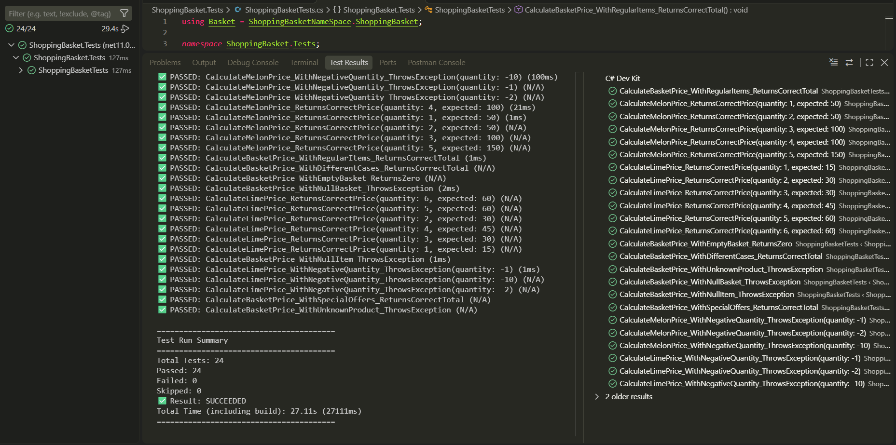

# Shopping Basket

A C# console application that calculates the total price of a shopping basket, applying product prices and special offers.

## Problem Statement

Given a list of shopping items identified by name, calculate the total cost of the basket.

An item may appear multiple times. For example, `["Apple", "Apple", "Banana"]` represents a basket containing two apples and one banana.

### Pricing Rules

| Product | Price | Special Offer |
|---|---:|---|
| Apple | 35p | No offer |
| Banana | 20p | No offer |
| Melon | 50p | Buy one, get one free |
| Lime | 15p | Three for the price of two (3 for 30p) |

## Approach & Implementation

1. **Learn C# basics:** Since I had not coded in C# before, I first familiarised myself with its syntax and fundamental concepts, including its similarities to Java.
2. **Understand the requirements:** I broke down the pricing rules and identified the special offers before starting the implementation.
3. **Validate the basket:** I validate the input before performing calculations. A null basket, null item or unknown product is rejected.
4. **Count individual items:** I use a case-insensitive dictionary to calculate the quantity of each product.
5. **Regular product pricing:** Apples and bananas are charged at their individual prices.
6. **Melon offer:** Every pair of melons costs 50p. If the quantity is odd, the remaining melon is charged at its individual price of 50p.
7. **Lime offer:** Every group of three limes costs 30p. Any remaining limes are charged at 15p each.
8. **Unit testing:** I wrote unit tests using xUnit to verify regular pricing, special offers, empty baskets, case-insensitive product names and invalid inputs.

### Use of AI

I used AI to help create xUnit test cases. The implementation was written by me rather than relying on AI to generate the complete solution.

### Reference

- [xUnit – Getting Started](https://xunit.net/docs/getting-started/v3/getting-started#using-dotnet-test)

## Requirements

- .NET 11 SDK
- Git

Check your .NET SDK installation:

```bash
dotnet --version
```

The project targets `net11.0`, so a compatible .NET 11 SDK is required.

## Project Structure

```text
shopping-basket-csharp/
├── ShoppingBasket/
│   ├── Program.cs
│   ├── ShoppingBasket.cs
│   └── ShoppingBasket.csproj
│
├── ShoppingBasket.Tests/
│   ├── ShoppingBasketTests.cs
│   └── ShoppingBasket.Tests.csproj
│
├── docs/
│   └── images/
│       └── unit-test-results.png
│
└── README.md
```

## Design

- **Program.cs:** Console application entry point. Creates a sample basket, calls the pricing method and displays the total.
- **ShoppingBasket.cs:** Contains the product price dictionary, basket validation, quantity counting and pricing calculations.
- **ShoppingBasket.Tests:** Separate xUnit test project covering regular pricing, special offers, case-insensitive product names, empty baskets and invalid inputs.

## Test Results

The unit test suite completed successfully.

| Result | Count |
|---|---:|
| Total tests | 24 |
| Passed | 24 |
| Failed | 0 |
| Skipped | 0 |

**Result: SUCCESS**

The screenshot below shows the test execution summary:



## Run Locally

### 1. Clone the repository

```bash
git clone https://github.com/0xfarben/shopping-basket-csharp.git
```

### 2. Open the project directory

Navigate to the repository root (the folder containing both project folders).

### 3. Restore dependencies

```bash
dotnet restore ShoppingBasket/ShoppingBasket.csproj
dotnet restore ShoppingBasket.Tests/ShoppingBasket.Tests.csproj
```

### 4. Run the application

```bash
dotnet run --project ShoppingBasket/ShoppingBasket.csproj
```

### 5. Run unit tests

```bash
dotnet test ShoppingBasket.Tests/ShoppingBasket.Tests.csproj
```

These commands work on Windows, macOS and Linux with the .NET 11 SDK installed. An IDE is optional.